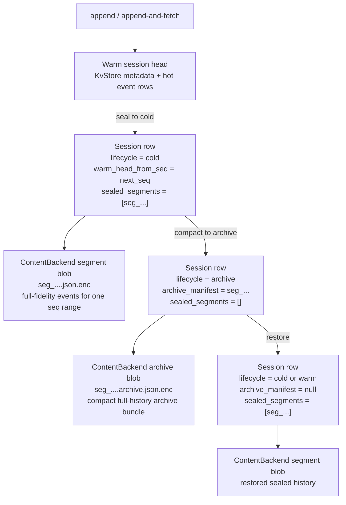

# AgentDB Architecture

This document describes the current implementation shape. The product thesis is
in [`agent-db.md`](agent-db.md), and the design commitments are in
[`DESIGN.md`](DESIGN.md).

## Layers

```text
agentdb.toml / CLI overrides
        |
        v
bin/agentdb-server
        |
        v
crates/agentdb-api        native tenant-scoped /api/... HTTP routes
        |
        v
crates/agentdb-core       runtime semantics: tenants, agents, sessions,
                          events, artifacts, records, skills, policy,
                          lifecycle, fork/replay, watch, context
        |
        +--> crates/agentdb-storage   KV + artifact content backends
        +--> crates/agentdb-index     text/vector helper indexes
        +--> crates/agentdb-meta      control-plane metadata helpers
```

SDKs and raw HTTP clients talk to `agentdb-api`. The API layer should stay thin:
decode requests, apply route-level validation, call runtime methods, and encode
responses.

`agentdb-core` owns durable runtime semantics. Framework adapters and SDKs
should not need to recreate ordering, idempotency, fork visibility, lifecycle, or
policy behavior in client code.

## Server Startup

The server is config-file first:

```bash
agentdb init-config
agentdb doctor --config agentdb.toml
agentdb serve --config agentdb.toml
```

`agentdb.toml` describes the bind address, storage mode, data directory, content
directory, and development-mode behavior. CLI flags are explicit overrides for
local runs and tests.

Normal single-node runtime settings are not configured through environment
variables. Docker, Compose, and Helm should mount a config file and start the
server with `--config`.

## Runtime Model

- **Tenant**: isolation, policy, quota, lifecycle, and watch boundary.
- **Agent**: runtime actor within a tenant.
- **Session**: ordered event log for one run or thread. Sessions can be forked.
- **Event**: append-only payload with tenant, agent, session, event ID, `seq`,
  kind, artifact refs, source refs, idempotency key, policy version, and time.
- **Artifact**: metadata in the runtime store plus bytes in the content backend.
- **Record**: searchable memory or observation with namespace, scope, tags, and
  optional source refs.
- **Skill**: registered tool/package manifest and agent binding.
- **Policy**: quota, lifecycle, retention, legal hold, and priority settings.

All public IDs are opaque typed strings: `ten_*`, `agt_*`, `ses_*`, `evt_*`,
`art_*`, `rec_*`, `skl_*`, and `pol_*`.

## HTTP Surface

The canonical API is the native `/api/...` route family:

```text
POST /api/tenants
GET  /api/tenants/{tenant_id}
POST /api/tenants/{tenant_id}/agents
POST /api/tenants/{tenant_id}/agents/{agent_id}/sessions
POST /api/tenants/{tenant_id}/sessions/{session_id}/events
GET  /api/tenants/{tenant_id}/sessions/{session_id}/events
POST /api/tenants/{tenant_id}/sessions/{session_id}/append-and-fetch
POST /api/tenants/{tenant_id}/sessions/{session_id}/fork
GET  /api/tenants/{tenant_id}/sessions/{session_id}/replay
GET  /api/tenants/{tenant_id}/sessions/{session_id}/subscribe
POST /api/tenants/{tenant_id}/sessions/{session_id}/context
GET  /api/tenants/{tenant_id}/watch
POST /api/tenants/{tenant_id}/artifacts
GET  /api/tenants/{tenant_id}/artifacts/{artifact_id}
GET  /api/tenants/{tenant_id}/artifacts/{artifact_id}/blob
POST /api/tenants/{tenant_id}/records
GET  /api/tenants/{tenant_id}/records/search
POST /api/tenants/{tenant_id}/records/search
POST /api/tenants/{tenant_id}/skills
POST /api/tenants/{tenant_id}/agents/{agent_id}/skills/bind
POST /api/tenants/{tenant_id}/policy/lifecycle-sweep
POST /api/tenants/{tenant_id}/policy/gc-sweep
POST /api/policy/worker/run
GET  /health/ready
```

There is no version-gating server flag or maintained Go SDK in the current
workspace.

An optional MongoDB compatibility listener can be enabled with `--mongo-bind` or
`[mongodb].bind`. It is intentionally narrow: initial support covers basic
handshake, collection discovery, `insert`, `find`, `count`, limited
`aggregate`, no-op `createIndexes`, and request/response AgentDB extension
commands such as `agentdbAppendAndFetch`, `agentdbFork`, `agentdbReplay`, and
`agentdbContext`. It is an adapter onto `agentdb-core`, not a separate storage
path or full MongoDB clone.

## Record Index Consistency

Record search follows DynamoDB-style secondary-index behavior:

- Searches with `sharding_key` use the owner-local LSI-like record index. This
  is the read-after-write path for a caller that knows the placement key.
- Searches without `sharding_key` use the GSI-like global record index. The
  global index is updated asynchronously from the durable record-index outbox
  and is eventually consistent.
- Record writes return `X-AgentDB-Record-Commit-Seq`. Reads can pass
  `min_visible_record_commit_seq` to require visibility through that commit.
  If the global index is stale for that token, the runtime falls back to
  owner-local repair from committed base records before replying.
- Python and TypeScript SDK clients remember the latest commit sequence per
  tenant and attach it to later record searches unless the caller supplied an
  explicit value.

Operational status is exposed at `GET /api/admin/indexes/records`, including
local/global watermarks, lag tokens, repair counters, and async apply failures.

## Event Append

Append is atomic per session. The runtime assigns the next session-local `seq`,
stores an event envelope, stamps policy metadata, records idempotency results,
and returns either the append result or an append-and-fetch response. Retries
with the same `Idempotency-Key` return the same result unless the payload
conflicts.

`append-and-fetch` is the hot path for agent loops: write the current turn and
return recent context in one request.

## Replay, Subscribe, Watch, Context

- `replay` reconstructs a fork-aware event view.
- `subscribe` returns an SSE replay snapshot from `from_seq`.
- `watch` returns generalized tenant/session/agent changefeed items.
- `context` builds a budgeted pack from recent events, searched records, active
  skills, and policy.

The current subscribe endpoint is deterministic replay-style SSE. Long-held
live push can be layered onto the same watch cursor model.

## Storage

The runtime persists metadata through `KvStore`. The server now supports:

- `RocksKvStore` for local-disk runtime metadata
- `SlateKvStore` for object-store-backed runtime metadata

Persistent single-node RocksDB mode stores runtime metadata under
`<data-dir>/runtime`. SlateDB mode stores runtime metadata under the fixed
object-store prefix `agentdb/runtime`.

Artifact content is separated from metadata through a `ContentBackend`. The
server now supports:

- `LocalFsContentBackend` for local-disk blobs
- `ObjectStoreContentBackend` for S3-compatible or other `object_store`
  backends

Local mode stores content under the configured `content_dir`; if no content
directory is configured, it uses `<data-dir>/content`. Object-store mode stores
artifacts, sealed cold segments, and archive bundles under the fixed prefix
`agentdb/content`.

The storage crate still contains lower-level RocksDB/SlateDB primitives and KV
contract tests because the runtime reuses those foundations.

The runtime code itself is `KvStore`-agnostic, so tiered session metadata works
with either `RocksKvStore` or `SlateKvStore`. The `agentdb-server` binary now
selects the KV backend and content backend from `agentdb.toml`.

## Session Tiered Storage

Session history now has three physical forms:

- `Warm`: appendable head in the runtime event store
- `Cold`: immutable sealed session segments in the content backend
- `Archive`: one compact archive bundle in the content backend plus a manifest
  in session metadata

Reads stay logical and session-centric: the runtime merges archive bundle,
sealed segments, and warm-head events into one ordered event stream.



Operationally:

- `transition_lifecycle(cold)` seals the current warm head into an immutable
  segment and removes hot event rows for that range.
- `transition_lifecycle(archive)` compacts full session history into one
  archive bundle and clears sealed-segment references.
- `restore(target=cold|warm)` materializes archived history back into a sealed
  segment so the session is no longer archive-backed.
- Appending to an archived or cold session reopens a warm head without
  rewriting old history.

This logic is implemented in `agentdb-core`; the API and SDKs expose it through
session lifecycle, storage, and restore endpoints.

## Deployment Shapes

- **In-memory dev/test**: throwaway runtime state for smoke tests and quick
  local experiments.
- **Persistent single-node**: RocksDB metadata plus local filesystem artifact
  content, configured by `agentdb.toml`.
- **Docker and Compose**: containerized single-node server with a mounted config
  file and data volume.
- **Helm**: evaluation-oriented Kubernetes deployment that mounts config through
  a ConfigMap and uses the same health endpoints as the binary.

Distributed control-plane behavior is not the current user-facing deployment
target. The priority is making one node easy to start, inspect, back up, upgrade,
and maintain.

## Policy And GC

Policy evaluation covers append, artifact writes, record writes, skill bindings,
context byte budgets, active-session quotas, lifecycle work units, and GC work
units. Soft deletes mark runtime objects first; tenant-scoped GC sweeps later
purge metadata, index entries, and artifact content when policy allows.

## SDKs And Adapters

The Python and TypeScript SDKs map directly to the native API. They generate
idempotency keys for mutating calls and expose typed ID aliases as opaque
strings.

Framework adapters should be thin. Their job is to map framework concepts onto
AgentDB tenants, agents, sessions, events, records, artifacts, and skills while
leaving runtime semantics on the server.
